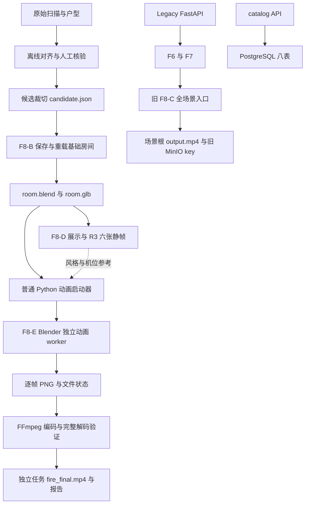
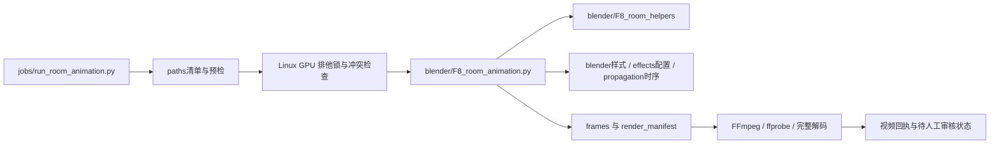
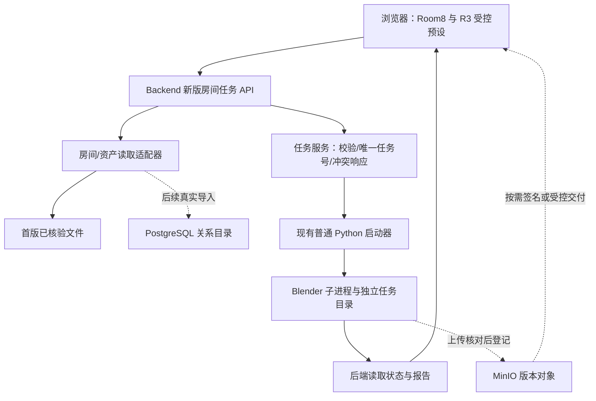

# 系统架构：当前实现与目标边界

2026-11-11正式路径去重：后端直接从backend.api.main启动，Legacy F6/F7/F8-C在render_engine/legacy；SQL唯一位置backend/database/migrations，公共预设只在configs/render；app/release源码副本及test包已移除，测试实体归入tests。源码指纹28份，不给旧任务改签名续跑。本文先前分批兼容叙述为历史过程，当前路径及执行边界以[正式说明](canonical_paths.md)为准；功能、R3、真实数据和部署拓扑不变。

更新：2026-11-09。需求依据：[PRD](PRD.md)。当前结构见代码映射；目标结构与接口均标为待实现。目录规范见 [PROJECT_ORGANIZATION](PROJECT_ORGANIZATION.md)，字段/路径规范见 [DATA_ASSET_SPEC](DATA_ASSET_SPEC.md)。

## 1. 系统目的与执行边界

将原始室内扫描、经核验的房间边界和相机点位，转为独立房间资产、演示传播时序及火灾视频。程序化视觉表达不承担 CFD 或真实灾前恢复的含义。

本地 Windows 编辑、离线测试和打包；远端 Ubuntu 执行 Blender 4.2 EEVEE。当前 FastAPI、OpenCV、Blender、FFmpeg 在同一应用容器，MinIO、PostgreSQL 独立服务。职责分层不等于立即拆容器；本轮不改变部署拓扑。

约束：业务 Python 不 import bpy；Blender 专用脚本仅在其子进程内运行。文件是引擎输入输出与运行状态依据；Blender 不连接 PostgreSQL。真实数据与凭证不入 Git，生产文件挂独立数据盘。不引入 Redis、MySQL 或新的队列服务。

## 2. Current：三条不同的实际链路

catalog 的真实数据导入尚未完成；图中的连接表示代码已有，不代表库内已有 Room8 资产。新版 Room8 任务当前由 CLI 启动，不经过旧渲染 API，也未完整登记到 MinIO。

### 2.1 Legacy 后端与对象存储

第5批后：`app/main.py`兼容入口 → `backend/api/main.py` → 原app/F6、F7及旧F8-C；`backend/services/observability.py`收敛旧状态/指标，`backend/adapters/minio/s3_io.py`处理原下载/上传及预签名。worker仍为app/F8_blender_render.py，子进程工作目录仍为安装根，未切换到新版Room8引擎。

实际路由包括 `/api/download_scene/{scene_code}`、`POST /api/generate_timeline/{scene_code}`、`POST /api/render/{scene_code}`、`GET /api/render/{scene_code}/status`、`GET /api/render/{scene_code}/share`、`POST /api/pipeline/{scene_code}`。它们是 Legacy 路由。旧 render 会删除场景根旧 output.mp4，不能用于新版 Room8 的网页任务或基线验证。

`backend/api/room_api.py`在`/api/catalog`下提供房间、点位、资产查询与资产签名；app/room_api继续兼容。路径中的room_id/asset_id仍是数据库整数主键。数据库连接按请求建立，失败返回503，不是启动强制前置；健康检查及旧分享接口不依赖数据库。没有文件fallback或新版Room8任务API。

数据库连接/迁移位于backend/adapters/postgres，显式导入与核验位于backend/cli；7个app模块与新实现保持同一对象。原SQL字节复制至backend/db/migrations，保留app/db副本；执行前及打包时检查一致，仍用原迁移名/SHA核对已应用记录。包初始化不迁移、不建表、不连服务。本轮不执行数据库写入。

Docker继续启动`app.main:app`，监控app/backend源码；Compose、环境变量和挂载不变。第6批Backend的对齐分析改为直接依赖只读Core，不导入tools；其余后端行为不变。目录说明见[backend/README](../backend/README.md)。

### 2.2 原始数据到独立房间

2026-11-09目录整理：只读断面实现位于tools/diagnostics；第4批将公共来源读取、坐标、指纹和候选裁切迁入render_engine/geometry，app保留同一模块对象的兼容路径。候选及F8动画不导入诊断或Backend；不改变高度判断或裁切策略，不表示服务器已部署新目录。

| 阶段 | 当前模块 | 输入与边界 |
| --- | --- | --- |
| 户型探测/对齐 | tools/diagnostics/probe_floorplan、analyze_floorplan；render_engine/geometry/floorplan_alignment | Core只读解析/分析；tools写报告，算法归属与人工review分开 |
| 裁切准备 | render_engine/geometry | 已核验多边形；三角面裁切插值保留 UV、XYZ、材质归属 |
| 独立资产 | render_engine/blender/F8_prepare_room_asset（F8-B） | 复用通过验证的OBJ导入轴向，保存blend后重开核验，再导出GLB |
| 展示/静帧 | render_engine/blender/F8_room_demo（F8-D）、propagation/room_demo_plan | 在基础资产上派生低墙/去顶展示副本，基础墙顶保持原样 |

Room8 原始 OBJ 与 Blender 世界坐标一致，不额外移动原 Z。基础 blend 为原始 XYZ，GLB 的 glTF Y-up 导出映射为 `(x,y,z) → (x,z,-y)`，由 manifest 记录，前端不得再无条件重复转换。

Room8 使用 11 顶点多边形、零外扩，源房间 6,835 个三角形，独立演示地板 9 面。`floor_z=-1.35m` 是主导下包络候选的工程近似。展示墙高 1.1m 是展示参数，不是建筑净高或实测天花板。

### 2.3 Room8 动画与可复现任务

第3批提取B/D/E辅助后，第4批将实现迁入`render_engine/{geometry,propagation,effects,blender,jobs}`，旧app函数名/CLI继续兼容；E不导入D/B入口，普通Python不导入bpy。默认配置按安装位置读取`configs/render/room_fire_round3.json`，与工作目录无关，旧app JSON保留原样兼容副本。

第6批将18个共用读取/解析/分析函数提取到floorplan_alignment，工具输出仍位于tools。`render_engine.paths.CODE_FILES`随之增加该Core，现为21份引擎Python、13份兼容入口与6份预设/兼容副本，共40份。预检接受安装根或旧app目录；缺失/改动拒绝，不能重签旧任务。R3、火烟和裁切算法不变，复现V1使用归档代码。完整包操作见[迁移说明](room_engine_migration.md)。

`room_animation_job.py` 负责文件契约、R3 冻结指纹、状态计算、续跑校验、统计和审核绑定。`room_demo_plan.py` 在房间内部诱导子图上重新 BFS：13 点，22 号在 0 秒启动，后续层在 1.5/3 秒，32、42 排除。当前是分点激活，不是 Hybrid 连续地表前沿。

每帧按绝对秒数重新赋值火、烟、点光及噪声状态；不依赖上一帧推进。overview 与 closeup 有独立 object/data/target，默认总览为正交相机。R3 艺术配置不因动画质量档切换而改写。

火点中心归属正确不等于火烟体积已经按墙裁切。当前 manifest 明确 `boundary_volume_clipping=false`；覆盖投影检查也不等于完整遮挡检查。越界、穿墙与视觉效果仍需人工审核。

任务位于房间级 `render_jobs/<render_job_id>/`；每次执行单独 `attempts/<attempt_id>/`。失败保留已产帧、日志及状态，续跑须相同输入/源码/配置且帧哈希验证通过。技术完成写 `awaiting_visual_review`，不自动开始另一任务。

### 2.4 GPU、状态与部署

生产配置采用 NVIDIA runtime、`NVIDIA_VISIBLE_DEVICES=all`、`compute,utility,graphics`；GPU 覆盖文件用 `gpus: !reset []` 清掉旧基础文件的 DeviceRequests。以当前文件与远端已成功任务为据，不沿用历史中间方案。

能运行 nvidia-smi 不足以证明 EEVEE 使用显卡。正式首帧实际 renderer 必须是 NVIDIA，拒绝 llvmpipe/未知后端；Room8 V1 已记录 L20/OpenGL 和 69 次 GPU 采样。4 卡可见不代表 4 卡并行。

Linux 锁使协作的新版任务串行，不能原子阻止其他用户或旧 API 的非协作任务。现有约 5 秒采样、85°C 告警、90°C 终止本任务保留；不宣称已具备全局 GPU 调度器。

| 状态/存储 | 当前权威范围 |
| --- | --- |
| 人工 review 与对齐报告 | 绑定输入哈希的空间归属结论，不能由状态文件代替 |
| 资产 manifest/validation | 基础房间来源和技术验证，不能冒充人工视频验收 |
| 新版 job/status.json、render_manifest.json | 当前任务运行状态与已登记产物；attempt 保留历史 |
| Legacy render_status.json | 旧场景根任务状态，不能覆盖新版任务 |
| PostgreSQL | 关系目录与查询摘要，尚未导入真实场景 |
| MinIO | 已上传对象；新版本地文件存在不等于已经上传 |

生产挂载关系、各层编号和防覆盖规则见数据规范。第7批发布实现归deploy/scripts，生产模板归deploy；release旧PowerShell命令转调，模板及独立prepare_deploy.sh保留SHA校验副本，输出仍release/out。prepare_deploy同时只读检查Legacy与房间活动任务，状态异常/损坏时停止；维护期仍需冻结新任务，不构成原子调度锁。根Dockerfile/开发Compose、端口与挂载不变。本轮不执行部署或Docker。

离线测试使用tests四组明确清单复用原test模块，禁止默认发现真实timeline集成与手工API探测；若继承真实DB/timeline启用变量则拒绝运行。报告新建不覆盖，跳过与失败分别记录。原测试实体继续保留，Windows离线通过不等于远端原Python/NVIDIA/视觉验收。操作边界见[tests](../tests/README.md)、[deploy](../deploy/README.md)及[收尾说明](migration_closeout.md)。

## 3. Target：最小网页闭环（尚未实现）

- Frontend：选择房间、查看预设、明确提交、轮询状态、播放；不访问数据库或 MinIO 管理凭证，不拼服务器绝对路径。
- Backend：校验业务 ID/受控 preset，解析到可信文件，调用普通 Python 启动器；读取任务状态并提供交付。阻塞任务不得占住 HTTP 请求直到渲染结束。
- Render Engine：只读取任务文件/可信资产，独立计算传播、渲染和编码。无浏览器、FastAPI、数据库依赖。
- 数据适配器：先接已核验文件，后接 PostgreSQL/MinIO；API 的房间身份、产物身份和审核含义保持一致。适配器本轮只定义边界，没有新增代码。

拟议 API 以 `/api/room-jobs` 区分旧入口：提交受控 Room8 任务；按 render_job_id 查询状态、产物、日志摘要。完整请求/响应约定见数据规范，尚未注册路由。内部 MVP 不等于可公开暴露，鉴权及公网入口另行验收。

## 4. 目标高度检测设计（仅设计）

从已核验房间多边形与原始 XYZ 表面采样，分别保留下包络、上包络；按高度容差聚类，统计有效样本占比、第一/第二候选差距、平面覆盖与连通性。选择可能的上下表面对，计算 `clear_height_m = ceiling_z - floor_z`；不能将模型极值或相机 Z 直接当作地板/顶部。

拟议结果字段：`method_version`、`input_sha256`、`sampling`、`floor_candidates`、`ceiling_candidates`、`selected_floor_z`、`selected_ceiling_z`、`clear_height_m`、`confidence`、`status`、`reasons`。候选包含高度、样本数/占比和空间覆盖。未确认值用 null，不补默认层高。

置信度等级与阈值尚待多房间样本标定，不先编造统一通过值。高可信结果将表示“允许工程近似”，不自动代表建筑语义确认；低可信、顶部缺失、多层平台或净高异常返回 `needs_review`。如允许工程回退，必须记录显式选择、原因和来源，不能静默采用 -1.35m。

保留 Room8 历史 487 点采样作为私有回归证据，增加未来的合成平层、多平台、缺顶和低覆盖测试。当前不替换算法、不重新裁切、不改变 R3 基线。

## 5. 演进与验证边界

先审阅目录/数据约定，再分批提取被诊断入口与裁切共同使用的纯函数，之后才移动文件。旧API、Blender同目录导入、测试AST提取、打包脚本及远端/tmp上传清单必须一起回归；不得按文件名删除“旧F8”或“诊断”。详见目录规范中的七批迁移。

后续源码变更按 [测试约定](../tests/README.md) 新建追溯测试。离线单元/API 替身、远端 PostgreSQL/MinIO 集成、Blender/GPU 与人工画面验收分别记录。单次 Room8 已出片不代表其他房间、网页、数据库导入或公网交付完成。

原架构和过期实施过程见 [历史快照](archive/20261107_pre_baseline/architecture.md)。
