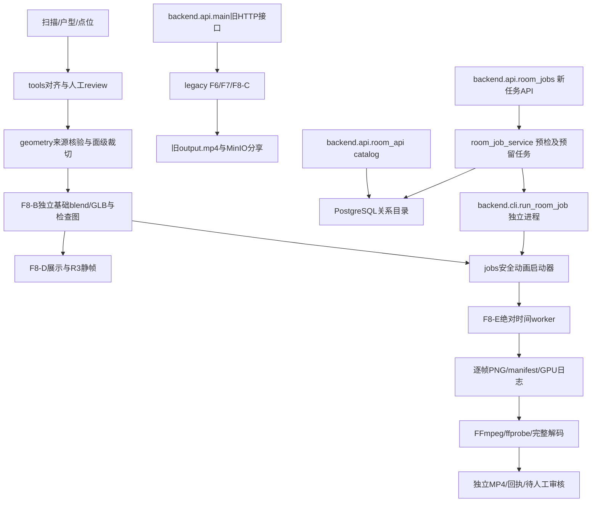

# 系统架构：当前实现与目标边界

更新：2026-11-13。需求见[PRD](PRD.md)，状态见[PROJECT_STATUS](PROJECT_STATUS.md)，逐文件用途见[根README](../README.md)，编号/存储契约见[DATA_ASSET_SPEC](DATA_ASSET_SPEC.md)。当前架构只有新路径；兼容期过程见[归档](archive/20261111_process/engineering_history.md)。

## 1. 执行环境与依赖

本地Windows编辑、离线测试、打包；远端Ubuntu运行Blender4.2 EEVEE。FastAPI/OpenCV/Blender/FFmpeg仍在同一应用容器，PostgreSQL和MinIO独立；目录拆分不等于服务拆分。业务Python不import bpy，Blender通过子进程运行，不连接数据库。

Backend复用引擎纯函数；Engine不反向依赖Backend/tools。诊断使用只读核心及纯build_plan，不因导入自动连库。包初始化不启动任务、不建表。真实资产和凭证不进Git，模型/视频不因整理代码改名或覆盖。

## 2. 三条实际链路

现有Room8 V1由CLI生成并保留；新版任务API57b53f1已部署，4秒48帧NVIDIA短片、查询/Range及同键复用已远端核对，网页尚未实现。本场景catalog版本1及29份原输入索引已导入；随后追加Room8指定6份交付的MinIO对象和数据库关联。API测试短片没有自动上传，图中的连线不代表全部附件已登记或所有故障路径已验收。

### Legacy与Backend

Docker启动backend.api.main:app，监控backend/render_engine；根开发Compose和deploy生产模板保留原端口、挂载及服务拓扑。API主实现负责原场景下载、旧时间线、旧渲染、状态和分享。F6/F7及旧F8-C位于render_engine/legacy；worker通过子进程启动，cwd显式为项目根。

旧POST /api/render/{scene_code}会处理场景根output.mp4，不能用于Room8新任务或V1核验。旧MinIO下载/上传/7天预签名由backend/adapters/minio提供；签名解决权限，不解决内网地址可达性。

/api/catalog提供场景房间、房间点位/资产及资产签名，路径room_id/asset_id是数据库整数主键，不是Room8字符串。连库按请求进行，失效返回503；健康和旧分享不以PostgreSQL为启动前置。没有自动文件fallback或用户权限系统。

SQL唯一位置为backend/database/migrations/001_rooms.sql。文件名/内容及schema_migrations校验不变，路径函数和打包按固定指纹保护；新结构另建后续迁移。迁移/账号授权、导入和资产上传均需显式调用，不随服务启动执行。

首批产物登记已实现并远端验收：services/room_registration只读构造计划，cli/register_room_assets负责互斥及独立回执，adapters/minio/room_objects验证专用私有桶并流式回读SHA，adapters/postgres/room_asset_repository验证已导入layout/review/点位后事务写入原八表。MinIO上传与数据库事务分开，失败保留对象供重试；不调用Blender，不修改原任务。任务外部ID/资产版本暂存render_jobs.config，所有摘要写入方共用场景advisory锁，尚无独立唯一列。首批登记使用独立/tmp目录；第二批已切换为burnroom-app:room-jobs-57b53f1并完成API短片核心路径验收，前端未实现。

新版/api/room-jobs只开放Room8/R3及test/final预设。room_job_repository校验已登记blend/人工核验绑定，固定原成片的R3相机参考；room_job_service在原GPU锁下预留原格式文件任务和SQL摘要，独立Python CLI等待管道握手后调用原安全启动器，以resume使用同一新任务号。持久幂等索引防止同键重复运行；独立输出不覆盖历史。查询以status/manifest为准；SQL仅摘要，失败不回滚成片。room_video核对回执及SHA，再提供200/单Range206/HEAD播放，无需MinIO直连。内部调用日志沿用HTTP trace/request及job上下文。接口、默认关闭开关、正式出片策略和恢复限制见[Backend](../backend/README.md)。未改变引擎29份保护清单、R3值或SQL。

### 独立房间与火烟

geometry包含OBJ/MTL/坐标、证据指纹、只读对齐和面级裁切；tools负责生成报告和人工检查资料。F8-B保存基础room.blend后重载核验，再导出GLB和派生视图；F8-D在基础资产上另存低墙/去顶展示，不重写基础几何。

Room8为11顶点、零外扩，原始XYZ不移动。floor_z=-1.35m为主导下包络平层近似，不等于建筑语义确认。GLB导出(x,y,z)→(x,z,-y)，浏览器不能再次无条件转换。技术检查与人工画面、GLB浏览器验收分别表述；只验证了Room8。

propagation/room_demo_plan在13内部点诱导子图上BFS，不经32/42外部点绕行；激活层为0/1.5/3秒。effects提供固定种子火舌、烟柱及曲线；blender样式模块创建节点/灯光。R3默认，R1/R2仅对比回归；没有Hybrid、CFD或按真实墙面限制火烟体积。参数见[R3指南](rendering/style.md)。

### 动画任务、GPU与交付

jobs启动器执行预检、共享GPU锁/冲突检查，再启动F8-E；每帧按绝对时间重新赋值，不依赖上一帧。overview/closeup相机object/data/target独立，默认正交总览。正式档24秒/720p/24fps/576帧，测试档960×540/12fps；风格与质量覆盖分开。

任务写rooms/<room_id>/render_jobs/<run_id>，尝试写attempts/<attempt_id>；失败保留帧和日志。PNG/相机/时刻/SHA与视频完整解码通过后才发布，状态为awaiting_visual_review；技术成功不自动视觉批准或启动另一任务。

render_engine.paths清单为26份Python和3份公共预设，共29份，包含公共operation_logging模块。旧28/40文件及V1任务不能用新代码改签续跑；当前快照包含绝对路径，同内容换路径也不保证续跑。复现V1恢复其归档版本，详情见[动画指南](rendering/animation.md)。

生产NVIDIA runtime请求compute,utility,graphics；GPU覆盖清除旧DeviceRequests。正式首帧验证真实NVIDIA上下文，拒绝llvmpipe/未知后端；nvidia-smi可见不等于EEVEE实际使用GPU。约5秒采样、85°C告警、90°C终止本任务；4卡可见不等于4卡并行。锁和部署状态检查不是共享服务器全局原子调度器。

## 3. 数据与状态的权威范围

| 数据 | 当前依据 |
| --- | --- |
| review/对齐报告 | 绑定输入的人工空间结论，不能由自动状态覆盖 |
| 基础manifest/validation | 资产来源及技术检查，不等于视频人工验收 |
| 新任务status/manifest | 运行状态与已登记产物，attempt保留历史 |
| Legacy render_status | 旧场景任务，不能覆盖新版job状态 |
| PostgreSQL | 本场景版本1关系及原输入索引已导入；Room8指定6份产物及任务摘要已登记 |
| MinIO | Room8指定6份交付已回读SHA验证；不代表其他磁盘文件自动上传 |

## 4. 下一阶段目标（未实现）

[公共操作日志](OBSERVABILITY.md)已实现：纯ASGI中间件覆盖HTTP结果，公共ContextVar/span连接主要CLI、Legacy守护线程与Room8子进程；JSONL服务分片和attempt事件分开存储，Markdown时间线由CLI生成。2026-11-12完成HTTP、catalog只读检查及Room8单帧GPU任务的远端最小验收，详见[发布记录](RELEASES.md)。无前端上报或新监控API，旧状态/逐帧/GPU/timing证据保持原职责。本场景真实导入及指定产物登记已完成；后续网页只支持Room8/R3受控任务，前端按钮经Backend调用现有安全启动器，查询状态和播放指定任务产物。

新版/api/room-jobs已部署并通过成功创建到短片技术完成、NVIDIA后端及同键复用核对，完整trace/历史分页/故障等尚未远端验证；sources提供已登记Room8可选版本，catalog仍提供整数ID的资产/点位查询。不得调用旧渲染API代替。前端不传任意脚本/配置路径、工作目录或绕过审核参数；数据库ID与业务ID由适配器转换。新任务产物不自动上传MinIO，仍通过显式登记CLI核对SHA再登记；对象成功/登记失败可重试，不能重启渲染补偿登记。

真实前端、全链路监控、鉴权、第二房间及东莞公网入口仍待独立实施。自动高度仅保留设计方向：分别输出上下候选及覆盖/连续性/置信度，低可信需人工判断，不用极值/众数冒充物理地板，也不替换当前Room8近似。
