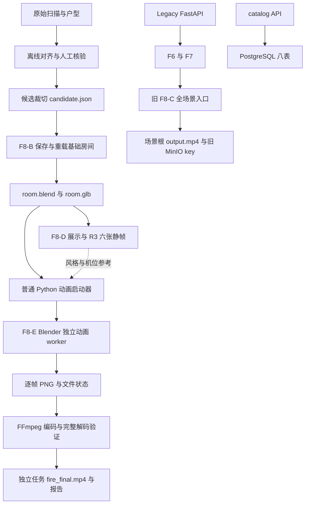
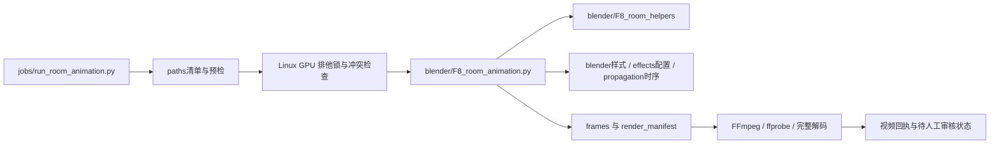
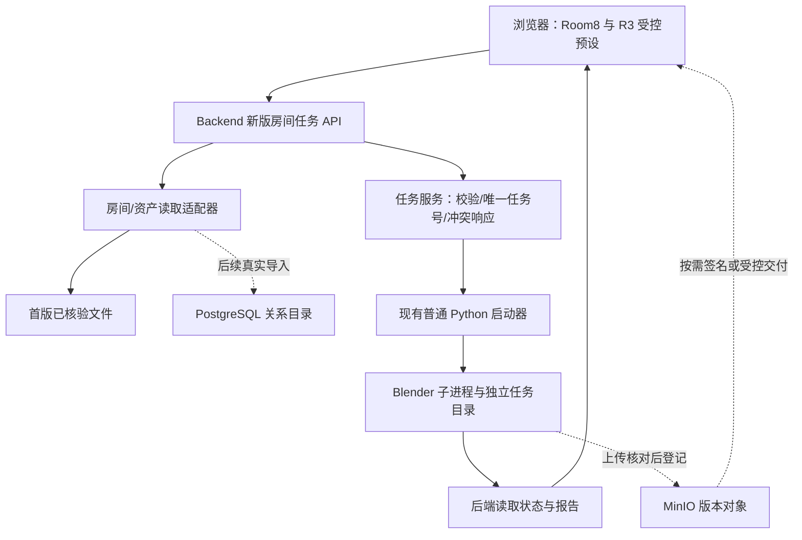

# engineering_history.md

2026-11-11合并的历史原文。来源提交：`fd3b3724a6526040f09dee8dd5eab57e64e33af3`。以下旧命令、路径、门禁和“当前状态”仅用于追溯，不作为运行指令。当前说明从[文档索引](../../README.md)进入。原文以Markdown源码保存，换行统一为LF；manifest.json记录原路径、工作副本SHA、Git blob及合并后字节范围，可提取校验。

<details>
<summary>docs/room_engine_migration.md</summary>

````markdown
# 第4批：新版Room8引擎与预设迁移

> 2026-11-11后续决定覆盖本文旧兼容约定：app/release源码与test旧包已移除，只使用新路径；SQL改为backend/database。当前操作见[正式路径说明](canonical_paths.md)，下文七批兼容过程仅作历史依据。本次不运行部署或渲染。

第7批后发布实现位于deploy/scripts，release/scripts旧命令继续转调；安装包仍输出release/out。本轮不改引擎40文件指纹。离线回归统一入口为`python -B -m tests.run_regression`，原test模块命令保留；完整仓库执行发布回归，不把Linux运行镜像等同于完整开发环境。见[发布边界](../deploy/README.md)及[收尾说明](migration_closeout.md)。

第5批后完整安装包还包含Backend源码及原样SQL，app旧入口依赖这些包；只传app文件仍不可用。Room8引擎及39文件指纹未变，数据库迁移/导入不会随打包、解压或普通引擎启动自动执行。具体边界见[Backend说明](../backend/README.md)。

2026-11-10第6批：共用对齐分析Core已独立，诊断源码迁入tools，Backend不导入诊断CLI。清单扩为40份，下面为当前完整包边界；不得用它续跑39文件清单的旧任务。算法/R3不改，工具见[tools/README](../tools/README.md)。

本轮只整理和离线验证，不部署、不重建容器、不重新出图或出片。旧V1资产、任务和配置保持原样。下列传输说明仅供之后明确授权运行时使用。

## 当前代码位置

实际实现位于[render_engine](../render_engine/README.md)，默认R3位于[configs/render](../configs/render/README.md)。app保留13份兼容模块，旧函数接口/CLI继续可用；旧全场景F8没有迁移。不能再使用历史文档中的“上传几个平铺脚本到/tmp”方案。

源码指纹由安装根目录计算，包含引擎、兼容入口和预设共40份文件；`preflight`仍接受旧app目录参数，也接受安装根。静帧同样使用完整清单。任何源码版本改变均新建任务；旧V1只能恢复归档版本运行，不能修改旧任务快照、帧记录或签名。

同一新版任务若需续跑，必须恢复原安装路径及完全相同的文件版本；不要换一个临时目录后强行复用旧帧。唯一安装目录用于隔离不同版本，不表示续跑可以更改源码位置。

## 本地PowerShell：以后需要传输时

在项目目录运行既有`release/scripts/build.ps1`生成tar.gz。安装包现在同时携带app、render_engine及三份configs/render预设；只复制命名Python源码/预设，不携带真实资产。缺失引擎文件/预设或兼容副本不一致时，打包失败并保留现场。脚本UTF-8 BOM保留。

此次不要求运行deploy.ps1或重建服务。未来如只验证独立引擎，可通过WinSCP把生成的tar.gz上传至服务器`/tmp/`，保持其唯一文件名；不要将归档内容直接覆盖现有部署或历史任务代码。

## 远程SSH：以后只读检查独立安装包

先进入既有Compose目录。将下方文件名占位符替换成实际包名；这些命令仅解压独立代码并看帮助，不启动渲染。正式执行前应确认当前没有依赖同一容器的其他维护动作。

```bash
cd ~/burnroom-prod/burnroom-deploy-package
package_name='替换为实际安装包文件名.tar.gz'
install_id=$(date -u +%Y%m%dT%H%M%SZ)-$(python3 -c 'import uuid; print(uuid.uuid4().hex[:8])')
install_root="/tmp/room8-engine-$install_id"
docker compose exec -T app-server mkdir "$install_root"
docker compose cp "/tmp/$package_name" "app-server:$install_root/package.tar.gz"
docker compose exec -T app-server tar -xzf "$install_root/package.tar.gz" -C "$install_root"
engine_root="$install_root/burnroom-deploy-package"
docker compose exec -T app-server python3 "$engine_root/app/run_room_animation.py" --help
printf 'Engine root: %s\n' "$engine_root"
```

逐条执行，任何一步失败先停止。变量只在当前SSH会话有效；不运行docker compose down、不改挂载、不删旧/tmp或任务。解压目标为唯一临时目录，不覆盖/app/data或现有部署。以后的正式操作必须保留整棵目录和这些文件的版本。

## 实际入口（需另外授权才运行）

- 动画启动器：`$engine_root/app/run_room_animation.py`，实际worker自动选取`$engine_root/render_engine/blender/F8_room_animation.py`。
- 默认R3：`$engine_root/configs/render/room_fire_round3.json`；省略--config也会按安装位置找到它。
- 静帧：Blender的--python指向`$engine_root/render_engine/blender/F8_room_demo.py`。
- 资产生成：Blender的--python指向`$engine_root/render_engine/blender/F8_prepare_room_asset.py`。

资产、点位、人工核验和render_jobs仍使用原数据盘路径。当前不重新裁切、不生成短片或完整视频，不能因帮助命令成功就宣称远端GPU/视觉验收通过。

## 本地验证范围

新增`test/test_engine_migration.py`，覆盖新旧导入同一性、旧接口替换、跨工作目录CLI、Blender入口导入替身、默认R3、全部源码指纹、旧任务拒绝、安装包完整性/私有文件排除、解压后独立导入、缺文件/配置分叉时打包中止及BOM。

原AST测试改为读取实际实现，不删除原相机、UV、时序、编码、失败保留断言。测试中的出片日志来自合成进程；没有执行真实Blender、数据库、SSH或Docker。当前测试数量和未验证项见[test/README](../tests/README.md)。

````

</details>

<details>
<summary>docs/migration_closeout.md</summary>

````markdown
# 第7批收尾与主线审阅边界

2026-11-10。Room8 V1保持原归档与原视频，不重渲染。本批落实deploy发布实现、release兼容入口、tests分组离线入口及部署保护，不迁移旧F6/F7/F8-C、不重构网页或导入数据。

| 已落地位置 | 兼容/保留内容 |
| --- | --- |
| deploy/scripts及生产模板 | release的PowerShell命令继续使用；输出仍为release/out；模板/保护shell保留受校验的兼容副本 |
| tests/{backend,engine,tools,deploy} | 四组显式模块注册；原test用例实体、fixture和unittest模块路径保留，不重复定义测试类 |
| tests/run_regression.py | 只执行离线清单，真实集成环境开关冲突即拒绝；报告新建不覆盖 |
| test/test_api.py | 写真实timeline的旧测试增加显式开关，不修改旧接口/业务行为 |

部署前原先只查Legacy状态，现在也拒绝任何房间任务的created/preparing/rendering/encoding状态。损坏JSON停止，不自动清理过期状态。只读检查与部署之间仍有竞争窗口；真正部署时应人工冻结任务提交，不宣称已建立跨进程原子调度器。

本批没有改引擎40份源码/预设清单、Backend业务、房间几何、SQL、端口、卷挂载或GPU风格。打包读取deploy生产模板，但其字节与原release一致；root Dockerfile/开发Compose继续作为入口。完整本地测试报告位于忽略目录release/out，不上传私有诊断/模型/视频。

最终离线回归295项：293通过、2项跳过，新增16项全部通过；镜像测试目录白名单调整后另有3项契约复核通过。40份引擎/预设和24份V1备份SHA不变；4份PowerShell语法与BOM、shell LF、Python3.11语法及文档链接检查通过。实际解释器为本地Python3.13/Pydantic2.10.6；两项跳过为真实PostgreSQL与可选Matplotlib。报告路径见[test/README](../tests/README.md)。

## 本批之后的必要动作

1. 审阅本批diff和离线回归后，由用户提交独立第7批提交，不混入网页任务。
2. 在合并前重新获取GitHub main最新引用并审阅差异。当前仅检查本地main与本地origin/main均为d5a5e42，main是整理分支祖先，分支较其多29个提交；本轮尚未实时查询远端main，不能据此保证未来无冲突。
3. 对照Room8 V1归档、R3与40份源码清单；迁移后源码属于新任务版本，不能换签名继续V1历史任务。用户审核后再决定PR/合并与标签，不自动merge、打tag或推送。
4. 远端复验使用完整源码检出与原依赖；先核对帮助/导入和部署配置，另行安排运行验收。Windows模拟GPU/视频测试不能替代远端；无需为本轮整理重做V1视频。

测试实体继续留在test、根Dockerfile/开发Compose保留是本轮明确的兼容选择，不把它们宣称为已全量物理迁移。后续功能开发时可逐组迁移并保持旧接口；它们不是当前合并必须清空的目录。数据库真实导入、新版MinIO登记、网页与Hybrid继续独立排期。

````

</details>

<details>
<summary>docs/canonical_paths.md</summary>

````markdown
# 正式路径去重：2026-11-11

本次是用户确认后的兼容期结束：源码只保留新路径，不再保留app、release源码副本或test包。仅本地实现与离线回归；不部署、不连接数据库、不运行Blender、不合并main。根README完整文件说明与过程文档合并属于下一项任务。

| 内容 | 唯一正式位置 |
| --- | --- |
| FastAPI启动 | backend.api.main:app |
| 原F6/F7/F8-C | render_engine/legacy/，旧HTTP接口保留；worker子进程工作目录显式为项目根 |
| Room8裁切、样式、动画 | render_engine/各职责包；普通Python不导入Blender worker |
| 诊断与手工API | tools/diagnostics及tools/integration/probe_scene_api.py |
| R1/R2/R3 | configs/render/room_fire_round*.json；内容不变，R3仍默认 |
| 数据库SQL | backend/database/migrations/001_rooms.sql；内容、文件名及已应用迁移记录不变 |
| 发布脚本、生产/GPU模板 | deploy/；不再使用release/scripts旧命令 |
| 测试 | tests/{backend,engine,tools,deploy,legacy,integration}；公共定位/清单在tests根 |

本地PowerShell、项目根目录：

```powershell
python -B -m tests.run_regression
.\deploy\scripts\build.ps1
```

本机已有测试环境可使用`release/out/backend-test-env/Scripts/python.exe`代替python。安装包和私有备份仍写入被忽略的release/out，保留原产物，不移动、不删除；这不是Git中的重复源码。deploy.ps1会连接服务器，本轮不运行。

普通Python入口改用`python -m render_engine.jobs.run_room_animation`、`python -m render_engine.geometry.prepare_room_candidate`；后端/诊断CLI使用其正式包路径。完整安装包必需，不能上传单个兼容脚本；旧app CLI已经移除，不提供回退别名。

28份源码/预设指纹覆盖25份引擎Python（含Legacy隔离包）与3份公共预设，没有旧入口/配置副本。源码集合已变，旧40文件任务不能改签名续跑；复现Room8 V1须恢复原归档代码。数据库基线用固定SHA256及已应用迁移校验保护，不能因为移除SQL副本而编辑既有迁移；公共预设打包也有批准指纹保护。

原测试用例移动后更新导入与源码定位，保留算法/材质/UV/时序/编码/失败保护断言；旧路径兼容断言改为唯一正式位置检查。新增tests/deploy/test_canonical_layout.py验证去重、SQL/R3、依赖隔离、清单及旧任务拒绝。tests/TEST_HISTORY.md是旧测试说明的迁移记录，不作为当前命令入口。

数据、原模型、人工review、基础room.blend、历史视频、任务快照和数据库均不修改。远端当前仍可能运行旧版代码，本地去重不代表已部署；远端升级与实际运行验收另行安排。更完整的README、日志基础设施和真实数据库导入按后续任务实施。

## 本地核验结果

完整离线回归303项：301通过、2项跳过（真实PostgreSQL未启用、可选Matplotlib未安装），其中本次新增8项全部通过；补充F6/F7合成逻辑9项全部通过，不读取真实全景图或生成真实timeline。使用既有Python3.13/Pydantic2.10.6隔离环境，生产依赖不改；没有执行真实渲染、数据库、SSH或Docker。

对照迁移前备份：239个运行函数AST一致（后端start_render仅将cwd改为显式项目根）；R1/R2/R3、SQL、生产模板、历史归档和24份V1文件SHA保持不变。96份Python通过3.11语法检查；新旧包导入依赖扫描、当前文档链接、git diff检查、PowerShell语法/BOM及Shell LF检查通过。原295项相关测试继续运行；旧兼容断言按用户决定改成唯一正式路径检查，没有删除功能回归断言来回避失败。

逐文件备份及移动清单位于忽略目录`release/out/canonical-cleanup/20261111T030731Z_a5db8a55/`，含before.json、mapping.json、verification.json、final_regression.json和完整测试日志。Git尚未提交；用户审阅后提交，未合并main或创建标签。

````

</details>

<details>
<summary>docs/PROJECT_ORGANIZATION.md</summary>

````markdown
# 项目职责目录与渐进迁移规范

2026-11-11后续用户决定：结束以下七批的兼容保留阶段。正式源码只使用backend/render_engine/tools/deploy/tests，移除app/release源码及test旧包，SQL改为backend/database。下面映射表中的“保留旧入口/副本”记录分批迁移过程，不再是当前执行约束。最新路径和边界见[正式说明](canonical_paths.md)。

更新：2026-11-10。**第1–7批已完成本地目录整理；远端复验与main合并仍待单独审阅。** app旧入口、test用例实体、release兼容入口继续保留，不创建前端骨架或删除Legacy源码。架构依据见[ARCHITECTURE](ARCHITECTURE.md)。

## 1. 两个分类维度

Frontend/Backend/Render Engine 是职责；运行代码、测试配置、诊断、历史资料、生成产物是用途。同一份几何函数可以被运行与诊断同时使用，不能因为文件名带 diagnose 就认定可删除。

| 用途 | 处理原则 |
| --- | --- |
| 正式运行 | 保留；迁移须保留入口、导入与部署兼容 |
| 测试/公共配置 | 与被测模块一同维护；R1/R2 仍用于回归，R3 冻结 |
| 辅助诊断 | 先拆正式链路依赖，再迁移 tools/diagnostics |
| 历史资料 | 原样归档并标明日期；过期指令不继续执行 |
| 可再生产物 | 放私有 data/ 或 release/out/，不提交模型/视频/真实诊断 |
| 待确认删除 | 只有引用、测试、文档、部署与历史依据均核对后再审阅 |
| Legacy | 旧系统仍有调用，不能与新版互相替换或直接删除 |

## 2. 目标结构（已落地部分见映射表）

```text
frontend/
  src/{pages,components,api,types}/
backend/
  api/{rooms,jobs,assets}/
  services/                    # 参数/任务/交付编排
  repositories/                # 关系目录抽象
  adapters/{files,postgres,minio}/
  cli/                         # 显式导入/核验
  db/migrations/
render_engine/
  analysis/                    # 烧损图像/起火点分析，独立于传播算法
  geometry/                    # OBJ/UV、多边形裁切、未来高度候选
  propagation/                 # 点位拓扑与房间 BFS
  effects/                     # 纯参数/几何生成
  blender/                     # bpy 专用入口及节点/镜头辅助
  jobs/                        # 普通 Python launcher、状态、编码、GPU监控
tools/
  diagnostics/                 # 非正式流程检查、断面图与API探测
  integration/                 # 需明确环境的手工集成检查
tests/{backend,engine,tools,deploy}/ # 分组入口已落地，旧test用例实体继续复用
configs/{render,schemas}/       # 公共预设；数据契约模式待落地
docs/                          # 当前需求、架构、状态、运行手册
  archive/                     # 不可当成当前操作指南
deploy/                        # 发布脚本/生产模板已落地；根Dockerfile/开发Compose保留
app/                           # 过渡保留，含新版及Legacy入口
test/                          # 原用例/替身及旧unittest模块路径
release/                       # 兼容入口/模板副本及原out目录
```

`configs/schemas/` 为以后实现请求校验的目标位置，本轮 Markdown 示例不等于已实现 JSON Schema。职责拆分不承诺同时拆镜像、服务或引入任务队列。

目标依赖方向：Frontend 通过 API 访问 Backend；Backend 通过文件契约和普通 Python 启动器调用 Render Engine；tools 可以使用引擎纯函数，Render Engine 不反向导入 tools 或 Backend。普通 Python 端不能导入 render_engine/blender 中的 bpy 模块。数据库 CLI 与引擎都需要的读取/变换逻辑归纯函数层，不再放在带业务编排的导入 CLI 内。

## 3. 当前文件到目标位置

| 当前文件/文件组 | 用途与职责 | 目标位置与前提 |
| --- | --- | --- |
| app/main.py、app/room_api.py | API兼容模块，ASGI入口保留 | 实现已迁backend/api；保留Legacy/catalog，不是新版jobs API |
| app/database.py、app/db/001_rooms.sql | 连接/迁移兼容模块与SQL副本 | 实现已迁backend/adapters/postgres，SQL原样复制至backend/db/migrations；新旧副本不一致则拒绝 |
| app/import_rooms.py、app/check_catalog.py | 导入/只读核验兼容CLI | 实现已迁backend/cli；依然延迟连库，build_plan被inspect间接复用 |
| app/s3_io.py | MinIO兼容模块 | 实现已迁backend/adapters/minio；原key/签名不变，新版登记另行开发 |
| app/observability.py | Legacy日志/状态/GPU监控兼容模块 | 实现已迁backend/services；未与新版引擎监控合并 |
| app/F6_detect.py | 烧损图像与起火点分析；旧 main 及测试调用 | render_engine/analysis/；保持评分语义，不顺便修改起火点选择 |
| app/F7_spread.py | 旧传播；旧 main 及测试调用 | render_engine/propagation/；保留旧 BFS 语义，不与房间 BFS 混写 |
| app/run_room_animation.py、app/room_animation_job.py | 兼容入口；启动/锁/编码/状态/续跑实现 | 已迁入render_engine/jobs；安装根寻址及完整源码指纹已适配 |
| app/F8_room_animation.py（E）、F8_room_demo.py（D）、F8_prepare_room_asset.py（B） | Blender兼容入口 | 实现已迁入render_engine/blender；保留原函数接口与CLI |
| app/F8_room_helpers.py、F8_room_fire_style.py | Blender公共辅助兼容模块 | 实现已迁入render_engine/blender；不被普通Python业务端导入 |
| app/room_fire_config.py | 配置校验、火舌/烟柱几何兼容模块 | 实现已迁入render_engine/effects；算法不变 |
| app/room_demo_plan.py | 展示分量/BFS兼容模块 | 整体迁入render_engine/propagation，暂不继续拆算法 |
| app/prepare_room_candidate.py、room_clip_geometry.py、room_source_io.py、room_source_inputs.py | 候选/几何/输入兼容模块 | 实现已迁入render_engine/geometry，不反向导入app/Backend/tools |
| app/analyze_floorplan.py | 对齐分析兼容模块 | 18个只读公共函数已进入render_engine/geometry/floorplan_alignment.py；报告CLI在tools/diagnostics/，继续导出原函数名 |
| app/inspect_room_asset.py | 历史坐标/高度检查兼容模块，保留公共函数名 | 实现已迁tools/diagnostics；继续复用Backend纯build_plan，无导入即连库行为 |
| app/diagnose_room_sections.py | 旧CLI/导入兼容，保留load_inputs/REQUIRED_CHECKS接口 | 已迁至tools/diagnostics/diagnose_room_sections.py；app指向同一模块 |
| app/room_section_geometry.py、app/room_section_plots.py | 旧导入兼容，保留断面/绘图函数 | 实现已迁至tools/diagnostics/；Matplotlib仍只在绘图时导入 |
| app/F8_inspect_room_import.py（F8-A） | Blender导入检查兼容入口 | 实现已迁tools/diagnostics/blender/；实际源文件仍支持独立上传，保留历史依据与静态测试 |
| app/probe_floorplan.py | 上游API探测兼容入口 | 实现已迁tools/diagnostics；实际源文件可独立使用，不提交真实返回包或appkey |
| app/F8_blender_render.py（F8-C） | 旧 main 绑定的 Legacy worker | 保留原入口；之后可迁至独立 legacy 区并保留兼容启动路径 |
| configs/render/room_fire_round1/2/3.json、旧app副本 | 默认预设与兼容副本 | 第4批原样复制，默认寻址已迁移；打包拒绝新旧副本不一致 |
| test/*.py、test/__init__.py | 当前用例/替身及显式集成测试，实体保留 | 第7批tests分组入口复用原模块；旧命令保留，不复制第二套测试类；新增收尾用例在tests/deploy |
| test_4dkankan.py | 根目录手工API兼容入口，不自动执行 | 实现已迁tools/integration/probe_scene_api.py；不再自动加载.env，必须显式--allow-network，输出脱敏；不随生产包发布 |
| release/scripts/*、release/*.yml、release/prod.env.example、Dockerfile、docker-compose.yml | 发布兼容入口与开发配置 | 第7批发布实现迁deploy/scripts，模板迁deploy；release保留PS转调/受校验副本，输出仍release/out；根Dockerfile/开发Compose不移动 |
| requirements*.txt、.gitignore、.dockerignore | 构建与依赖边界 | 根目录先保留；诊断绘图库继续与生产依赖分开 |
| docs/room_*.md、docs/database.md | 操作依据与部分历史实验 | 建索引标明适用版本；核对引用后再逐篇归档，不能全量移走 |
| PRD_V1.1.md、architecture.md | 原始累积文档 | 原样快照在 archive；根文件保留兼容链接，新有效规范在 docs/ |
| data/**、release/out/** | 私有资产/诊断/任务/备份/安装包 | 继续忽略；服务器/本地目录不因代码迁移而改名 |

## 4. 必须先拆的依赖

整理前链条：`prepare_room_candidate → diagnose_room_sections.load_inputs → inspect_room_asset → import_rooms → analyze_floorplan`；其中数据库连接是延迟执行，并非引擎必须连库。第1批已将候选入口改为 `prepare_room_candidate → room_source_inputs → room_source_io`，不再导入诊断或后端工具。第6批将公共读取/对齐函数抽到引擎只读层：Backend导入CLI直接使用floorplan_alignment，不依赖tools；对齐/断面诊断使用同一核心。inspect仍可使用Backend的纯build_plan，原inspect/diagnose函数名继续兼容。Render Engine不反向导入Backend/tools。

整理前动画链条：`F8_room_animation → F8_room_demo / F8_prepare_room_asset / F8_room_fire_style`。第3批改为B/D/E直接依赖`F8_room_helpers`，E不再导入D/B入口；D/B旧函数名继续导出。辅助函数实现不变，普通Python业务端不能导入这些bpy模块。

测试既有普通导入，也有 AST 提取和按文件路径读取。候选、断面、导入、静帧、动画及 GPU 测试都要随实际引用回归，不能只替换 import 字符串。

### 打包与双执行环境也是迁移依赖

| 现有约束与证据 | 迁移必须满足的条件 |
| --- | --- |
| build.ps1/.dockerignore已包含tools诊断源码及新版引擎/命名预设 | 打包只复制21份命名引擎Python、3份预设与10份明确诊断Python；integration及额外工具不发布；缺失或配置分叉即失败，安装包/解压导入需测试 |
| Dockerfile启动app.main:app，reload监控app及backend | 保留兼容入口；仅增加新源码监控，不改服务、端口、挂载或生产依赖 |
| 新Blender入口和兼容脚本从自身位置加入安装根，使用包导入 | 普通Python/Blender的导入与帮助替身均检查；不能再单文件上传/tmp |
| render_engine.paths统一列出40份源码/预设，静帧和动画共用 | 第6批新增只读分析核心，从39扩为40；覆盖包初始化、路径模块、兼容脚本及新旧配置；缺失/改动拒绝，不给旧任务改签名 |
| run_room_animation.py:151 由 points 路径推导共享锁根，worker会核对同一锁 | 目录整理不得把点位移到另一层缓存而造成多个锁根；本阶段保持数据路径不变，未来改动须显式设计共享锁位置 |

以上是迁移约束；已落地范围按下表标明。新增目录的产物仍只写入私有data/，不能混入源码安装包。

## 5. 已确认的七批迁移

| 批次 | 范围 | 当前状态/回归重点 |
| --- | --- | --- |
| 1 | app内提取OBJ/MTL、坐标与指纹公共函数 | 已完成；输入保护及旧接口 |
| 2 | 三个断面工具迁入tools/diagnostics | 已完成；兼容入口、CLI与安装包 |
| 3 | app内提取B/D/E共用Blender辅助 | 本地实现；UV/材质/坐标、相机、源码指纹、旧接口与打包；未远端渲染 |
| 4 | 新版Room8引擎及配置迁入render_engine/configs | 本地实现；13个app兼容模块、默认R3、worker、打包/镜像上下文与完整指纹已适配；未远端部署/渲染 |
| 5 | Backend API、数据库工具和MinIO适配分组整理 | 本地实现；7份兼容模块、原样SQL、完整打包与API回归；未导入数据或远端部署 |
| 6 | 其余诊断/集成工具逐组迁移 | 本地完成；4份app兼容入口、只读分析核心、手工API显式开关及10份诊断打包；历史Z轴工具保留，未真实联网/诊断 |
| 7 | 测试/部署目录收尾及稳定性审阅 | 本地完成；tests分组/离线报告、deploy实现/release兼容、房间任务部署保护；原测试实体保留；不自动合并main |

每批结束均回看diff、调用链与对应测试。新源码使用新任务；复现V1从原基线归档恢复，不能把旧任务改签名后续跑。跨目录迁移时立即更新部署引用，不能等第7批才修打包。

每批分独立提交，说明改变的路径、兼容入口、实际测试和回退提交。不把高度算法、Hybrid、网页或数据库导入混入迁移。

## 6. 文档与产物边界

当前新文档是有效入口；原文档和过期配置过程作为历史材料。Git 当前已忽略 /data/ 与 release/out/，但不代表任意目录下的 PNG/BLEND/GLB 都自动忽略。真实产物一律进入上述私有目录；不为此全局忽略所有 PNG，避免屏蔽以后合法的合成测试图。

下一次提交前看 diff 与新增文件清单，只提交源码/测试/公共配置/脱敏文档。文件移动需用户审阅处置清单后实施，本次没有任何待自动删除的文件。

## 7. 本次工程审阅结论

2026-11-07：目录职责划分可作为目标规范；修正了 F6 分类和“部署最后迁移”的歧义，补齐打包、双执行环境、源码指纹与共享锁约束。**目标结构可保留，当前尚不具备直接批量移动文件的条件。**

第1批已在app内提取room_source_io与room_source_inputs，保留旧函数名，新增两份测试。2026-11-09第2批将diagnose_room_sections、room_section_geometry、room_section_plots实现迁至tools/diagnostics；app保留共享模块对象的兼容入口，打包和镜像上下文只增加这组Python源码。既有高度、裁切与F8动画算法不动；安装包内容/解压导入、旧CLI和相关离线回归分别检查。服务器尚未部署本次迁移。

第4批已按用户授权迁移13个新版实现，保留全部app兼容入口；旧F8-C和Backend未移动。默认预设及完整源码清单按安装根寻址，打包/镜像上下文同批适配。205项相关离线回归中204通过、1项可选绘图库测试跳过；实际GPU未重渲染。剩余第5–7批仍逐批实施，不因本批完成而批量移动其他代码。

第5批已迁移7个Backend实现，保留app入口和原SQL副本；15份后端Python及1份SQL纳入打包，SQL内容不变，增加缺失/副本不一致阻断。ASGI入口仍app.main:app，仅增加backend热重载路径。251项相关回归249通过、2项跳过，真实数据库/远端部署未执行。Room8引擎及其源码指纹完全不改。剩余第6–7批继续分批审核，不删除Z轴工具或混入新网页功能。

2026-11-10第6批完成4个诊断实现及1个手工集成实现迁移。18个共享函数独立进入引擎只读层，Backend不再导入诊断CLI；旧函数与CLI保留。279项相关回归277通过、2项跳过，新增16项全部通过。原火烟、传播、裁切及R3字节不变；完整源码清单新增分析核心为40份，旧任务不能重签续跑。第7批仅继续测试/部署收尾与稳定性审阅，不自动合并main。

第7批完成发布实现/生产模板归位与分组离线回归入口。原test实体和根Dockerfile/开发Compose明确保留，避免批量路径变化；release命令不变。模板/独立shell新旧副本一致才打包；准备/渲染/编码中的房间任务阻断部署，真实timeline测试显式启用。实际测试、尚未远端验证项及合并边界见[收尾说明](migration_closeout.md)与[test/README](../tests/README.md)。没有数据库操作、Docker运行、渲染、提交或main合并。

````

</details>

<details>
<summary>docs/PROJECT_STATUS.md</summary>

````markdown
# 项目状态与下一步

2026-11-11：用户要求main只保留新源码路径，已实施正式去重与backend/database改名，测试实体统一到tests；原七批兼容结构不再是最终布局。当前步骤仅本地实现与离线验证，未部署/合并，结果见[正式路径说明](canonical_paths.md)。下一项为根README及文档整理，之后实现公共操作日志，再安排远端验收及真实数据库导入。

更新：2026-11-10。本文记录交付状态，不替代 [PRD](PRD.md)；代码/资产基线见 [RELEASES](RELEASES.md)。

## 已完成、部分完成、待开发

| 项目 | 状态 | 已有证据/剩余边界 |
| --- | --- | --- |
| 旧后端、F6/F7/F8、MinIO 分享 | 已实现，保留 Legacy | 历史服务器链路已跑通；不是新版房间 API |
| 户型获取与 XY 核验 | 本场景已人工核验 | 6 条房间记录、22 点；22 客厅、32 门口、42 户型外、Room11 无效 |
| Room8 独立资产 | 远端技术检查通过 | 基础 blend 保存/重载、GLB 导出、UV/材质/贴图及坐标检查通过；仅此房间已验证 |
| R3 火焰/烟雾/灯光与独立总览 | 人工认可为演示风格 | 原配置冻结；仍有已知火焰生命周期与后段节奏限制 |
| Room8 正式视频 | 已远端出片，阶段性演示接受 | 24秒/720p/24fps/576帧；约6分钟，实际L20；不宣称无条件产品验收 |
| 基线本地备份 | 关键交付物核验完成 | 129 项通过、逐文件SHA与独立ZIP；原帧及4份R3参考附件未下载 |
| 整理分支 | 已由用户建立 | chore/room8-v1-baseline；起点6725223，整理前工作区干净 |
| 统一目录/数据规范与新文档 | 七批本地整理完成，待主线审阅 | 引擎/预设、Backend、诊断、发布实现与分组测试入口已落位；app/release兼容及test实体保留；未远端部署、合并main或实施数据库/MinIO登记协议 |
| PostgreSQL 八表/查询/导入工具 | 实现与部署已有，真实导入未完成 | 不是“还没设计库”，也不是“已有全部真实房间数据” |
| 新版资产/视频登记 MinIO | 待开发/验收 | 旧上传和catalog附件上传代码不能替代房间任务登记 |
| 新版网页及房间任务 API | 待开发 | 文件适配器、提交/状态/播放闭环均未落地 |
| 第二房间 | 未验证 | 不将 Room8 专用任务预检宣称为通用多房间引擎 |
| 东莞公网成片入口 | 已定方向，待条件确认 | 复用实验室网站、楼下主动上传；未部署 |

## 当前必须保留的限制

- 火焰约前 8–11 秒按不同激活时间退出，后半段以烟为主，视觉变化有限；V1 暂不重渲染。
- 没有 Hybrid 贴地前沿，也没有按真实墙面裁切火烟体积；内部点筛选不能替代视觉越界检查。
- floor_z=-1.35m 为 Room8 平层近似，未确认真实地板/顶面/墙厚语义，也未完成灾前重建。
- 新版任务安全锁只约束协作入口；旧 API/外部手动任务仍可能冲突。GPU 4卡可见，当前成片证据为单卡工作。
- 关系表尚无独立的外部任务号/资产版本字段及完整审核状态；后续需显式设计迁移，不能把文件ID当整数主键。
- 根 README、原 PRD/architecture 与旧操作手册存在历史步骤；当前入口见 [文档索引](README.md)，不自动执行旧渲染命令。

## 后续五步与门禁

| 顺序 | 范围 | 审核/完成条件 |
| --- | --- | --- |
| 规范审阅 | [目录映射](PROJECT_ORGANIZATION.md)、[数据关联](DATA_ASSET_SPEC.md)、PRD/架构 | 已确认；按七批计划实施 |
| 经审查的清理 | 先解耦复用函数，再迁移工具/新版引擎，最后部署路径 | 每批独立提交、对应测试与旧入口兼容；不顺带改R3/算法 |
| 稳定主线 | 全量相关回归、资产/代码关系复核、PR审查 | 检查main更新与冲突后由用户合并；标签单独确认，不自动创建 |
| 最小网页闭环 | Room8、R3受控预设、新版任务/状态/播放 | 从新API实际调通当前引擎，旧API不被误调用 |
| 数据与复用 | PostgreSQL真实导入、MinIO新版登记、第二房间 | 原人工结论保留、版本可追溯、第二房间单独验收 |

生命周期、Hybrid、自动高度算法实现、用户权限和完整产品化独立排期。自动高度本轮只纳入设计；不成为网页或基线整理的新前置。

## 本轮交付核验口径

2026-11-07文档整理已按字节保存原文档，并检查链接、JSON示例和指纹。2026-11-09第2批迁移三个断面实现；第3批在app内提取9个Blender辅助函数，B/D/E保留旧名，动画不再导入B/D入口。静帧/动画指纹及上传说明包含新模块。SQL、Compose、Dockerfile、渲染预设及真实资产保持不变。

第2批离线回归178项：177通过、1项可选Matplotlib图片测试跳过。第3批新增公共辅助/源码保护测试，并复查原算法与24份V1备份SHA；当前本地验证见[test/README](../tests/README.md)。未执行Docker、远端部署、数据库操作或新的Blender/GPU渲染。当前源码用于新任务，不能给V1旧任务改签名续跑。

第3批回归190项：189通过、1项可选Matplotlib测试跳过。第4批完成新版引擎/配置目录迁移，回归205项：204通过、1项跳过；R3参数不变，未远端部署/渲染。

第5批完成Backend目录迁移：7份app兼容模块、15份后端Python与1份原样SQL，API/CLI/旧worker路径保留。打包/镜像上下文增加所需文件，Docker只追加backend重载监控；Compose、生产依赖及真实数据不变。完整相关回归251项：249通过、2项跳过（禁用真实PostgreSQL集成，缺少可选Matplotlib）；新增18项全部通过。43个原函数核对仅有预期导入/路径适配，39份引擎源码及24份V1备份SHA不变。测试使用本地Python3.13/Pydantic2.10.6，远端原环境尚未复验，详见test/README。下一批为其余诊断/集成工具迁移，不导入真实数据。

2026-11-10第6批完成：4个诊断实现进入tools/diagnostics，手工API检查进入tools/integration；原app/根入口保留。18个共享分析函数进入引擎只读层，Backend不再依赖诊断CLI；高度/Z轴/墙体依据保留。手工API不再自动加载.env，须显式允许联网，输出仅脱敏状态/数量；本轮没有真实请求。279项离线回归277通过、2项跳过，新增16项全部通过。火烟/裁切/传播及R3配置不变，源码清单因新增公共模块扩为40份，仅用于新任务，不改签旧任务。未部署、连库、渲染或改写真实资产；下一步为第7批测试/部署收尾及main合并前审阅，不自动合并。

第7批：deploy保存发布实现和生产模板；release保留旧命令/受校验副本，输出目录不变。tests提供四组显式离线入口和防覆盖测试报告，原test用例实体继续复用。增加Room8活动任务部署阻断、真实timeline测试显式开关，不改变业务算法；本地测试与未验证边界见[test/README](../tests/README.md)。下一步是审阅本批、检查最新main与PR/合并计划，不自动部署或打标签。远端原环境回归、PostgreSQL真实导入、新版MinIO登记与网页仍未完成。

本批最终回归295项：293通过、2项跳过，新增16项全部通过；40份引擎/预设及24份V1备份指纹不变。收紧测试目录镜像白名单后另复核3项部署契约通过。新旧打包命令、失败阻断和输出隔离均使用临时合成仓库验证，未连接真实服务器。

````

</details>

<details>
<summary>docs/ARCHITECTURE.md</summary>

````markdown
# 系统架构：当前实现与目标边界

2026-11-11正式路径去重：后端直接从backend.api.main启动，Legacy F6/F7/F8-C在render_engine/legacy；SQL唯一位置backend/database/migrations，公共预设只在configs/render；app/release源码副本及test包已移除，测试实体归入tests。源码指纹28份，不给旧任务改签名续跑。本文先前分批兼容叙述为历史过程，当前路径及执行边界以[正式说明](canonical_paths.md)为准；功能、R3、真实数据和部署拓扑不变。

更新：2026-11-09。需求依据：[PRD](PRD.md)。当前结构见代码映射；目标结构与接口均标为待实现。目录规范见 [PROJECT_ORGANIZATION](PROJECT_ORGANIZATION.md)，字段/路径规范见 [DATA_ASSET_SPEC](DATA_ASSET_SPEC.md)。

## 1. 系统目的与执行边界

将原始室内扫描、经核验的房间边界和相机点位，转为独立房间资产、演示传播时序及火灾视频。程序化视觉表达不承担 CFD 或真实灾前恢复的含义。

本地 Windows 编辑、离线测试和打包；远端 Ubuntu 执行 Blender 4.2 EEVEE。当前 FastAPI、OpenCV、Blender、FFmpeg 在同一应用容器，MinIO、PostgreSQL 独立服务。职责分层不等于立即拆容器；本轮不改变部署拓扑。

约束：业务 Python 不 import bpy；Blender 专用脚本仅在其子进程内运行。文件是引擎输入输出与运行状态依据；Blender 不连接 PostgreSQL。真实数据与凭证不入 Git，生产文件挂独立数据盘。不引入 Redis、MySQL 或新的队列服务。

## 2. Current：三条不同的实际链路



catalog 的真实数据导入尚未完成；图中的连接表示代码已有，不代表库内已有 Room8 资产。新版 Room8 任务当前由 CLI 启动，不经过旧渲染 API，也未完整登记到 MinIO。

### 2.1 Legacy 后端与对象存储

第5批后：`app/main.py`兼容入口 → `backend/api/main.py` → 原app/F6、F7及旧F8-C；`backend/services/observability.py`收敛旧状态/指标，`backend/adapters/minio/s3_io.py`处理原下载/上传及预签名。worker仍为app/F8_blender_render.py，子进程工作目录仍为安装根，未切换到新版Room8引擎。

实际路由包括 `/api/download_scene/{scene_code}`、`POST /api/generate_timeline/{scene_code}`、`POST /api/render/{scene_code}`、`GET /api/render/{scene_code}/status`、`GET /api/render/{scene_code}/share`、`POST /api/pipeline/{scene_code}`。它们是 Legacy 路由。旧 render 会删除场景根旧 output.mp4，不能用于新版 Room8 的网页任务或基线验证。

`backend/api/room_api.py`在`/api/catalog`下提供房间、点位、资产查询与资产签名；app/room_api继续兼容。路径中的room_id/asset_id仍是数据库整数主键。数据库连接按请求建立，失败返回503，不是启动强制前置；健康检查及旧分享接口不依赖数据库。没有文件fallback或新版Room8任务API。

数据库连接/迁移位于backend/adapters/postgres，显式导入与核验位于backend/cli；7个app模块与新实现保持同一对象。原SQL字节复制至backend/db/migrations，保留app/db副本；执行前及打包时检查一致，仍用原迁移名/SHA核对已应用记录。包初始化不迁移、不建表、不连服务。本轮不执行数据库写入。

Docker继续启动`app.main:app`，监控app/backend源码；Compose、环境变量和挂载不变。第6批Backend的对齐分析改为直接依赖只读Core，不导入tools；其余后端行为不变。目录说明见[backend/README](../backend/README.md)。

### 2.2 原始数据到独立房间

2026-11-09目录整理：只读断面实现位于tools/diagnostics；第4批将公共来源读取、坐标、指纹和候选裁切迁入render_engine/geometry，app保留同一模块对象的兼容路径。候选及F8动画不导入诊断或Backend；不改变高度判断或裁切策略，不表示服务器已部署新目录。

| 阶段 | 当前模块 | 输入与边界 |
| --- | --- | --- |
| 户型探测/对齐 | tools/diagnostics/probe_floorplan、analyze_floorplan；render_engine/geometry/floorplan_alignment | Core只读解析/分析；tools写报告，算法归属与人工review分开 |
| 裁切准备 | render_engine/geometry | 已核验多边形；三角面裁切插值保留 UV、XYZ、材质归属 |
| 独立资产 | render_engine/blender/F8_prepare_room_asset（F8-B） | 复用通过验证的OBJ导入轴向，保存blend后重开核验，再导出GLB |
| 展示/静帧 | render_engine/blender/F8_room_demo（F8-D）、propagation/room_demo_plan | 在基础资产上派生低墙/去顶展示副本，基础墙顶保持原样 |

Room8 原始 OBJ 与 Blender 世界坐标一致，不额外移动原 Z。基础 blend 为原始 XYZ，GLB 的 glTF Y-up 导出映射为 `(x,y,z) → (x,z,-y)`，由 manifest 记录，前端不得再无条件重复转换。

Room8 使用 11 顶点多边形、零外扩，源房间 6,835 个三角形，独立演示地板 9 面。`floor_z=-1.35m` 是主导下包络候选的工程近似。展示墙高 1.1m 是展示参数，不是建筑净高或实测天花板。

### 2.3 Room8 动画与可复现任务

第3批提取B/D/E辅助后，第4批将实现迁入`render_engine/{geometry,propagation,effects,blender,jobs}`，旧app函数名/CLI继续兼容；E不导入D/B入口，普通Python不导入bpy。默认配置按安装位置读取`configs/render/room_fire_round3.json`，与工作目录无关，旧app JSON保留原样兼容副本。

第6批将18个共用读取/解析/分析函数提取到floorplan_alignment，工具输出仍位于tools。`render_engine.paths.CODE_FILES`随之增加该Core，现为21份引擎Python、13份兼容入口与6份预设/兼容副本，共40份。预检接受安装根或旧app目录；缺失/改动拒绝，不能重签旧任务。R3、火烟和裁切算法不变，复现V1使用归档代码。完整包操作见[迁移说明](room_engine_migration.md)。



`room_animation_job.py` 负责文件契约、R3 冻结指纹、状态计算、续跑校验、统计和审核绑定。`room_demo_plan.py` 在房间内部诱导子图上重新 BFS：13 点，22 号在 0 秒启动，后续层在 1.5/3 秒，32、42 排除。当前是分点激活，不是 Hybrid 连续地表前沿。

每帧按绝对秒数重新赋值火、烟、点光及噪声状态；不依赖上一帧推进。overview 与 closeup 有独立 object/data/target，默认总览为正交相机。R3 艺术配置不因动画质量档切换而改写。

火点中心归属正确不等于火烟体积已经按墙裁切。当前 manifest 明确 `boundary_volume_clipping=false`；覆盖投影检查也不等于完整遮挡检查。越界、穿墙与视觉效果仍需人工审核。

任务位于房间级 `render_jobs/<render_job_id>/`；每次执行单独 `attempts/<attempt_id>/`。失败保留已产帧、日志及状态，续跑须相同输入/源码/配置且帧哈希验证通过。技术完成写 `awaiting_visual_review`，不自动开始另一任务。

### 2.4 GPU、状态与部署

生产配置采用 NVIDIA runtime、`NVIDIA_VISIBLE_DEVICES=all`、`compute,utility,graphics`；GPU 覆盖文件用 `gpus: !reset []` 清掉旧基础文件的 DeviceRequests。以当前文件与远端已成功任务为据，不沿用历史中间方案。

能运行 nvidia-smi 不足以证明 EEVEE 使用显卡。正式首帧实际 renderer 必须是 NVIDIA，拒绝 llvmpipe/未知后端；Room8 V1 已记录 L20/OpenGL 和 69 次 GPU 采样。4 卡可见不代表 4 卡并行。

Linux 锁使协作的新版任务串行，不能原子阻止其他用户或旧 API 的非协作任务。现有约 5 秒采样、85°C 告警、90°C 终止本任务保留；不宣称已具备全局 GPU 调度器。

| 状态/存储 | 当前权威范围 |
| --- | --- |
| 人工 review 与对齐报告 | 绑定输入哈希的空间归属结论，不能由状态文件代替 |
| 资产 manifest/validation | 基础房间来源和技术验证，不能冒充人工视频验收 |
| 新版 job/status.json、render_manifest.json | 当前任务运行状态与已登记产物；attempt 保留历史 |
| Legacy render_status.json | 旧场景根任务状态，不能覆盖新版任务 |
| PostgreSQL | 关系目录与查询摘要，尚未导入真实场景 |
| MinIO | 已上传对象；新版本地文件存在不等于已经上传 |

生产挂载关系、各层编号和防覆盖规则见数据规范。第7批发布实现归deploy/scripts，生产模板归deploy；release旧PowerShell命令转调，模板及独立prepare_deploy.sh保留SHA校验副本，输出仍release/out。prepare_deploy同时只读检查Legacy与房间活动任务，状态异常/损坏时停止；维护期仍需冻结新任务，不构成原子调度锁。根Dockerfile/开发Compose、端口与挂载不变。本轮不执行部署或Docker。

离线测试使用tests四组明确清单复用原test模块，禁止默认发现真实timeline集成与手工API探测；若继承真实DB/timeline启用变量则拒绝运行。报告新建不覆盖，跳过与失败分别记录。原测试实体继续保留，Windows离线通过不等于远端原Python/NVIDIA/视觉验收。操作边界见[tests](../tests/README.md)、[deploy](../deploy/README.md)及[收尾说明](migration_closeout.md)。

## 3. Target：最小网页闭环（尚未实现）



- Frontend：选择房间、查看预设、明确提交、轮询状态、播放；不访问数据库或 MinIO 管理凭证，不拼服务器绝对路径。
- Backend：校验业务 ID/受控 preset，解析到可信文件，调用普通 Python 启动器；读取任务状态并提供交付。阻塞任务不得占住 HTTP 请求直到渲染结束。
- Render Engine：只读取任务文件/可信资产，独立计算传播、渲染和编码。无浏览器、FastAPI、数据库依赖。
- 数据适配器：先接已核验文件，后接 PostgreSQL/MinIO；API 的房间身份、产物身份和审核含义保持一致。适配器本轮只定义边界，没有新增代码。

拟议 API 以 `/api/room-jobs` 区分旧入口：提交受控 Room8 任务；按 render_job_id 查询状态、产物、日志摘要。完整请求/响应约定见数据规范，尚未注册路由。内部 MVP 不等于可公开暴露，鉴权及公网入口另行验收。

## 4. 目标高度检测设计（仅设计）

从已核验房间多边形与原始 XYZ 表面采样，分别保留下包络、上包络；按高度容差聚类，统计有效样本占比、第一/第二候选差距、平面覆盖与连通性。选择可能的上下表面对，计算 `clear_height_m = ceiling_z - floor_z`；不能将模型极值或相机 Z 直接当作地板/顶部。

拟议结果字段：`method_version`、`input_sha256`、`sampling`、`floor_candidates`、`ceiling_candidates`、`selected_floor_z`、`selected_ceiling_z`、`clear_height_m`、`confidence`、`status`、`reasons`。候选包含高度、样本数/占比和空间覆盖。未确认值用 null，不补默认层高。

置信度等级与阈值尚待多房间样本标定，不先编造统一通过值。高可信结果将表示“允许工程近似”，不自动代表建筑语义确认；低可信、顶部缺失、多层平台或净高异常返回 `needs_review`。如允许工程回退，必须记录显式选择、原因和来源，不能静默采用 -1.35m。

保留 Room8 历史 487 点采样作为私有回归证据，增加未来的合成平层、多平台、缺顶和低覆盖测试。当前不替换算法、不重新裁切、不改变 R3 基线。

## 5. 演进与验证边界

先审阅目录/数据约定，再分批提取被诊断入口与裁切共同使用的纯函数，之后才移动文件。旧API、Blender同目录导入、测试AST提取、打包脚本及远端/tmp上传清单必须一起回归；不得按文件名删除“旧F8”或“诊断”。详见目录规范中的七批迁移。

后续源码变更按 [测试约定](../tests/README.md) 新建追溯测试。离线单元/API 替身、远端 PostgreSQL/MinIO 集成、Blender/GPU 与人工画面验收分别记录。单次 Room8 已出片不代表其他房间、网页、数据库导入或公网交付完成。

原架构和过期实施过程见 [历史快照](archive/20261107_pre_baseline/architecture.md)。

````

</details>
